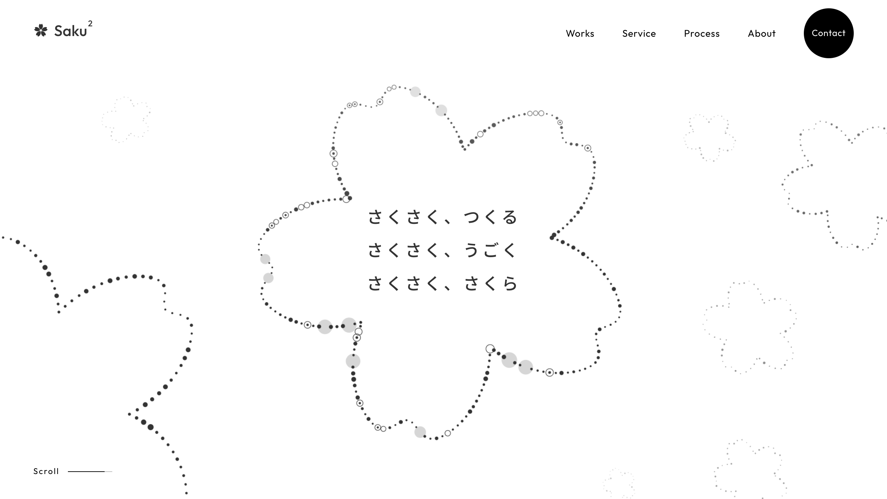
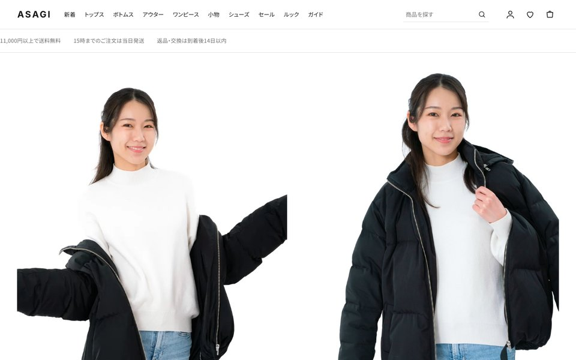
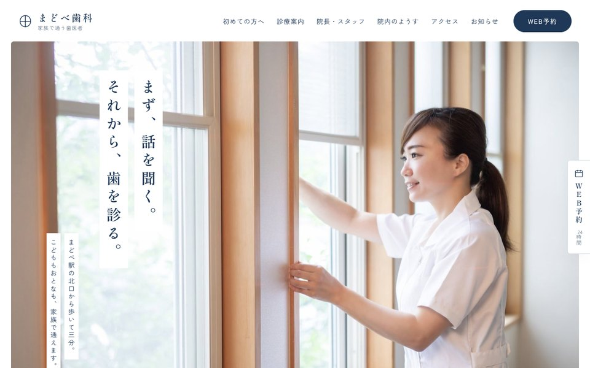
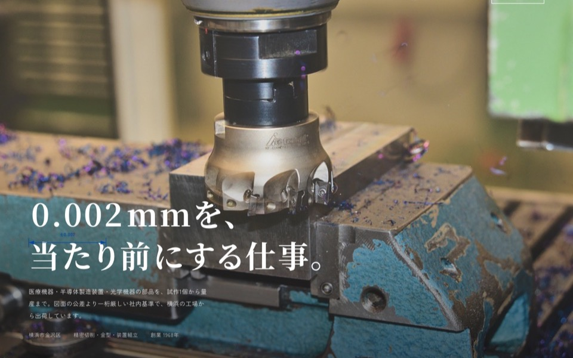
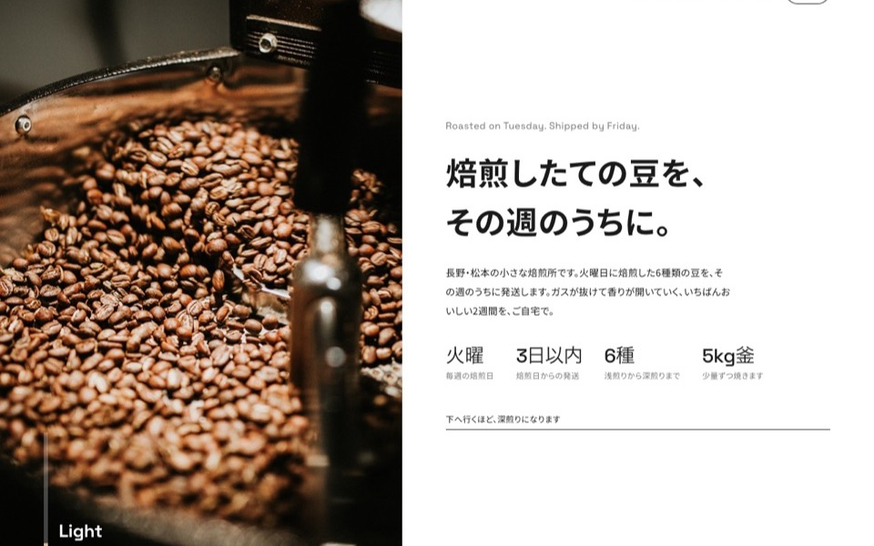
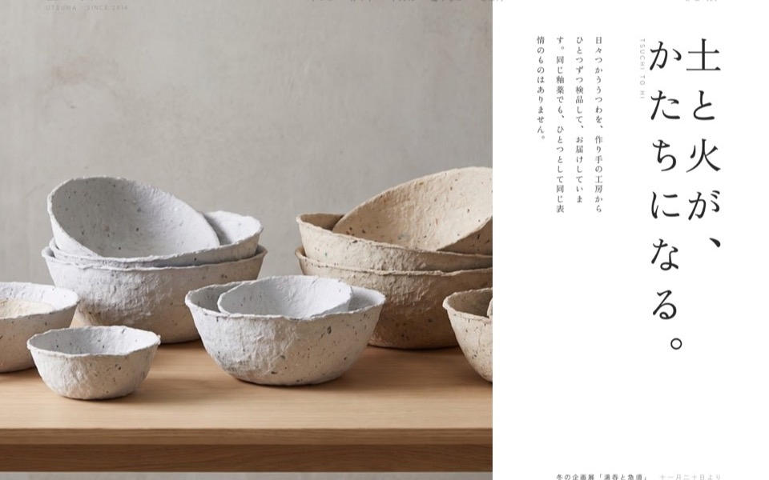
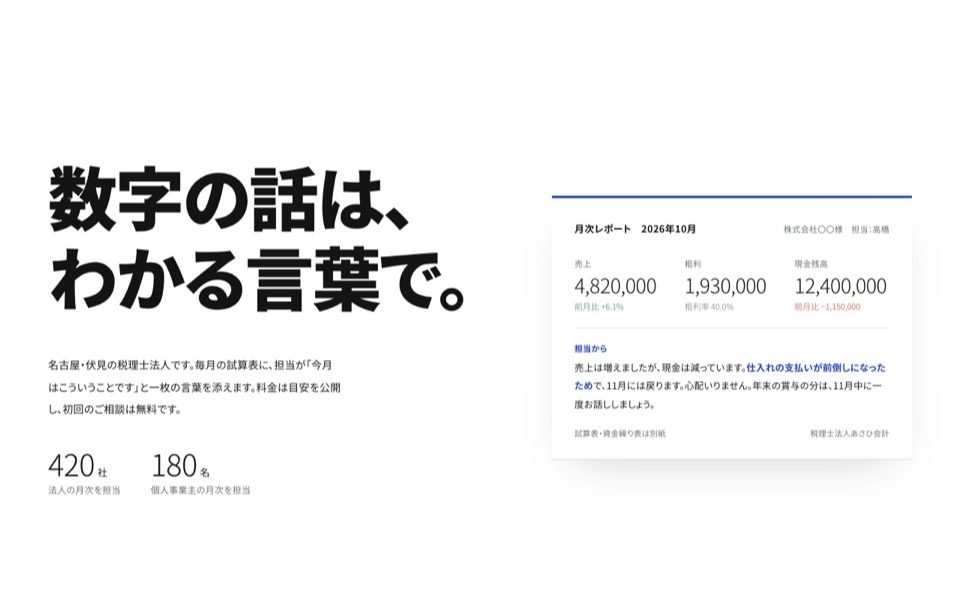
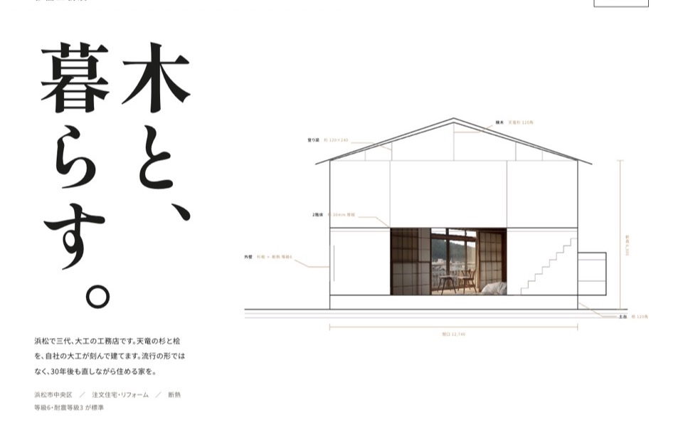
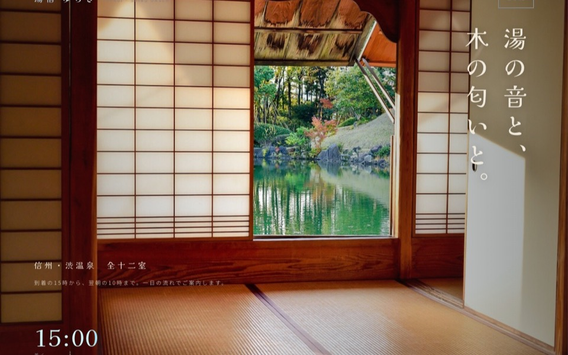
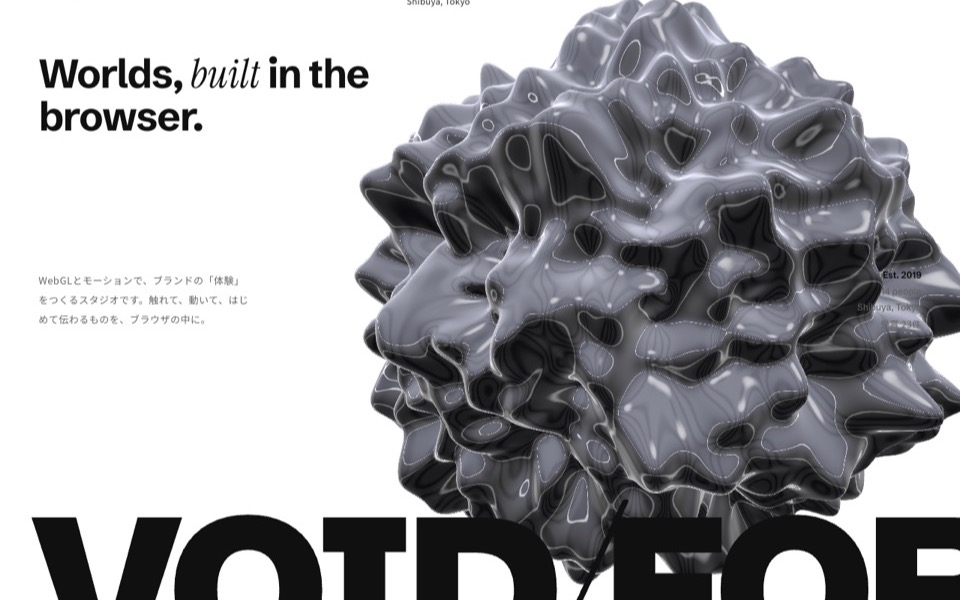

<a id="readme-top"></a>

<div align="center">
  <a href="https://yokoyama-dev.com/">
    
  </a>

  <h1 align="center">Saku²</h1>

  <p align="center">
    Web制作をしている Yuki Yokoyama のポートフォリオサイトと、架空のクライアントを想定した制作サンプル10件です。
    <br />
    <br />
    <a href="https://yokoyama-dev.com/"><strong>サイトを見る »</strong></a>
    <br />
    <br />
    <a href="https://yokoyama-dev.com/portfolio/">制作事例</a>
    &middot;
    <a href="https://yokoyama-dev.com/service/">サービス</a>
    &middot;
    <a href="https://yokoyama-dev.com/about/">運営者情報</a>
    &middot;
    <a href="README.md">English</a>
  </p>

  <p align="center">
    <a href="https://github.com/yokoyama0523/portfolio/actions/workflows/check.yml"></a>
    <a href="https://github.com/yokoyama0523/portfolio/actions/workflows/deploy.yml"></a>
    
    
    
    
  </p>
</div>

<p align="center">
  
</p>

<details>
  <summary>目次</summary>
  <ol>
    <li><a href="#このプロジェクトについて">このプロジェクトについて</a></li>
    <li><a href="#制作サンプル">制作サンプル</a></li>
    <li><a href="#使っている技術">使っている技術</a></li>
    <li><a href="#はじめかた">はじめかた</a></li>
    <li><a href="#コマンド">コマンド</a></li>
    <li><a href="#ディレクトリ構成">ディレクトリ構成</a></li>
    <li><a href="#しくみ">しくみ</a></li>
    <li><a href="#公開">公開</a></li>
    <li><a href="#開発に参加する">開発に参加する</a></li>
    <li><a href="#ライセンス">ライセンス</a></li>
    <li><a href="#連絡先">連絡先</a></li>
    <li><a href="#謝辞">謝辞</a></li>
  </ol>
</details>

## このプロジェクトについて

Web制作の屋号 Saku² のポートフォリオサイト [yokoyama-dev.com](https://yokoyama-dev.com/) と、そこで紹介している制作サンプル10件のソースコードです。どのサンプルも、架空の会社・店舗のための1つのサイトとして、情報設計・デザインから動くフォームまで作っています。

- **全ページを静的に出す：** 全ページ（ECサンプルの商品ページを含む）をビルド時にHTMLにしてから、ブラウザで動かしています。
- **1つのアプリに11のサイト：** ポートフォリオと10のサンプルを、1つの React Router のアプリで持っています。CSSとフォントはルートごとに読み込むので、ほかのサイトの見た目が混ざりません。
- **動くフォーム：** 予約・見積もり・注文手続きのフォームは、入力チェック、空き枠、合計金額の計算まで動きます。アパレル通販のサンプルは、カート・会員・注文・在庫・管理画面を、ブラウザの中（`localStorage`）だけで動かしています。
- **デザイントークン：** 色・文字・余白・レイアウトの値は Tailwind CSS v4 の `@theme`（サンプルは CSS 変数）に、文言とパスはデータのファイルにまとめ、部品には書いていません。
- **画像の最適化：** vite-imagetools でビルド時に縮小し、`srcset` と幅・高さを付けています。

<p align="right">(<a href="#readme-top">先頭へ</a>)</p>

## 制作サンプル

会社・店舗・人物はすべて架空です。

| | |
|---|---|
| [](https://yokoyama-dev.com/portfolio/ec/)<br>**ASAGI**（アパレル通販）<br>一覧・商品・カート・注文手続き・マイページ・管理画面 | [](https://yokoyama-dev.com/portfolio/dental/)<br>**まどべ歯科**（歯科医院）<br>診療案内と、空き枠から選ぶ予約フォーム |
| [](https://yokoyama-dev.com/portfolio/corp/)<br>**株式会社ミナト精機**（部品メーカー）<br>会社案内と、図面を添える見積もり・工場見学の申し込み | [](https://yokoyama-dev.com/portfolio/coffee/)<br>**KUMO ROASTERY**（コーヒー豆の通販）<br>焙煎度で並ぶ商品と、定期便の注文手続き |
| [](https://yokoyama-dev.com/portfolio/ceramic/)<br>**土と火**（器の店）<br>一点ものの商品ページと、のし・包装を選べる注文手続き | [](https://yokoyama-dev.com/portfolio/tax/)<br>**税理士法人あさひ会計**（税理士事務所）<br>料金の目安と、初回相談の申し込み |
| [](https://yokoyama-dev.com/portfolio/house/)<br>**杉浦工務店**（工務店）<br>施工事例と、見学会の予約 | [](https://yokoyama-dev.com/portfolio/ryokan/)<br>**湯宿 ゆらぎ**（温泉旅館）<br>スクロールで時間が進むトップと、宿泊の予約 |
| [](https://yokoyama-dev.com/portfolio/salon/)<br>**SOU.hair**（美容室）<br>メニューと、スタイリスト・日時を選ぶ予約 | [](https://yokoyama-dev.com/portfolio/motion/)<br>**VOID/FORM**（Web制作会社）<br>three.js の3Dと、スクロールに合わせた動き |

<p align="right">(<a href="#readme-top">先頭へ</a>)</p>

## 使っている技術

| 用途 | 使っているもの |
|---|---|
| フレームワーク | [React](https://react.dev/) 19.1.10、[React Router](https://reactrouter.com/) 7.18.5（フレームワークモード・プリレンダー） |
| ビルド | [Vite](https://vite.dev/) 7.3.7、[vite-imagetools](https://github.com/JonasKruckenberg/imagetools) 10.0.1 |
| 見た目 | [Tailwind CSS](https://tailwindcss.com/) 4.3.3（ポートフォリオ）、CSS（サンプル）、[Fontsource](https://fontsource.org/) |
| 動き | [GSAP](https://gsap.com/) 3.15.0、[Lenis](https://lenis.darkroom.engineering/) 1.3.27、[three.js](https://threejs.org/) 0.187.0、Canvas 2D |
| 品質 | [TypeScript](https://www.typescriptlang.org/) 5.8.3（strict）、[Biome](https://biomejs.dev/) 2.5.1 |
| 公開 | [Cloudflare Pages](https://pages.cloudflare.com/)、[wrangler](https://developers.cloudflare.com/workers/wrangler/) 4.156.1、GitHub Actions |

<p align="right">(<a href="#readme-top">先頭へ</a>)</p>

## はじめかた

### 必要なもの

- Node.js 22.18 以上（版は [`web/.node-version`](web/.node-version) にあります）
- npm

### インストール

```sh
git clone https://github.com/yokoyama0523/portfolio.git
cd portfolio/web
npm ci
npm run dev
```

`npm run dev` が出したURLを開きます。ポートフォリオは `/`、サンプルは `/portfolio/<id>/` です。

<p align="right">(<a href="#readme-top">先頭へ</a>)</p>

## コマンド

`web/` で実行します。

| コマンド | すること |
|---|---|
| `npm run dev` | 開発サーバーを起動する |
| `npm run check` | Biome で整形とリントを確かめる |
| `npm run format` | Biome で整形し、安全な修正をかける |
| `npm run typecheck` | ルートの型を作って、TypeScript で確かめる |
| `npm run build` | 全ページを `build/client` にプリレンダーし、サイトマップ・`robots.txt`・`_headers`・`_redirects` を作る |
| `npm run deploy -- --branch=<ブランチ>` | `build/client` を Cloudflare Pages に上げる（`CLOUDFLARE_API_TOKEN` と `CLOUDFLARE_ACCOUNT_ID` が要る） |

<p align="right">(<a href="#readme-top">先頭へ</a>)</p>

## ディレクトリ構成

```
web/
├── app/
│   ├── config.ts            サイト全体の設定（名前・URL・パス・アイコン）
│   ├── root.tsx             HTMLの骨組みとエラー画面
│   ├── routes.ts            ポートフォリオと全サンプルのルート
│   ├── site/                ポートフォリオ
│   │   ├── app.css          デザイントークンと独自のユーティリティ
│   │   ├── components/      部品（orbit/ はトップの動き）
│   │   ├── data/            文言・パス・画像
│   │   └── routes/          トップ・制作事例・サービス・運営者情報
│   ├── samples/
│   │   ├── <id>/            サンプル1件：case.json・content/・styles/・pages/・routes.ts・assets/・media/
│   │   └── shared/          サンプルどうしで使う部品・フォーム・入力チェック
│   └── shared/              meta タグとアクセス解析
├── scripts/                 ビルドの後処理（サイトマップ・_headers・_redirects）
└── public/                  そのまま配るファイル
```

<p align="right">(<a href="#readme-top">先頭へ</a>)</p>

## しくみ

- **ルート：** `app/routes.ts` で、ポートフォリオのルートと各サンプルの `routes.ts` をまとめています。サンプルごとに、レイアウト・フォント・CSSを持っています。
- **描画：** `ssr: false` とプリレンダーです。URLのクエリで中身が変わるところは、ハイドレーションのあとに読むようにして、プリレンダーのHTMLと最初の描画を合わせています。
- **状態：** 通販のサンプルは、`localStorage` に保存する React のコンテキストで状態を持ち、サンプルごとに別のキーを使っています。
- **文言：** サンプルの文言は `content/`、ポートフォリオの文言は `site/data/` にあります。`case.json` から、制作事例の一覧・フッター・ページ数・サイトマップ・旧URLの転送が作られます。
- **トップの動き：** `orbit/math.ts`（数式）・`orbit/scene.ts`（点の形）・`orbit/timeline.ts`（場面と文字の出入り）・`orbit/renderer.ts`（Canvas 2D の描画）に分けています。

<p align="right">(<a href="#readme-top">先頭へ</a>)</p>

## 公開

| ブランチ | 役割 | 公開先 |
|---|---|---|
| `feature/*` | 作業 | — |
| `develop` | まとめる | — |
| `staging` | 本番の前の確認 | https://staging.yokoyama-dev-portfolio.pages.dev/ |
| `main` | 本番 | https://yokoyama-dev.com/ |

- [`check.yml`](.github/workflows/check.yml)：すべてのプルリクエストと、`develop`・`staging`・`main` への push で、Biome・型チェック・ビルドを動かします。
- [`deploy.yml`](.github/workflows/deploy.yml)：`staging` と `main` への push で、ビルドして Cloudflare Pages に上げます。リポジトリのシークレット `CLOUDFLARE_API_TOKEN` と `CLOUDFLARE_ACCOUNT_ID` が要ります。

<p align="right">(<a href="#readme-top">先頭へ</a>)</p>

## 開発に参加する

1. `develop` からブランチを作る：`git checkout -b feature/<名前>`
2. 変更して、`npm run check`・`npm run typecheck`・`npm run build` を通す
3. `develop` にプルリクエストを出す。リリースは `develop` → `staging` → `main` の順に、プルリクエストで進めます

決まり：

- デザイントークンを使い、Tailwind の任意値（`[...]`）は使わない。足りないときはトークンか `@utility` を足す
- 文言・パス・画像は、部品ではなく `data/`・`content/`・`config.ts` に置く
- コードにコメントを書かない。名前で意味が分かるようにする
- パッケージの版は完全に固定し、公開から2週間以上たったものを使う

<p align="right">(<a href="#readme-top">先頭へ</a>)</p>

## ライセンス

© 2026 Yuki Yokoyama. All rights reserved. このコードと素材の利用・複製・再配布は許可していません。

<p align="right">(<a href="#readme-top">先頭へ</a>)</p>

## 連絡先

Yuki Yokoyama（Saku²）：[yokoyama-dev.com](https://yokoyama-dev.com/)・[クラウドワークス](https://crowdworks.jp/public/employees/5842694)

<p align="right">(<a href="#readme-top">先頭へ</a>)</p>

## 謝辞

- サンプルの写真は [ぱくたそ](https://www.pakutaso.com/)・[Unsplash](https://unsplash.com/)・[Pexels](https://www.pexels.com/)・[Pixabay](https://pixabay.com/) のフリー素材で、人物はモデルです。出典は各サンプルの `assets/CREDITS.txt` にあります。
- このREADMEの構成は [Best-README-Template](https://github.com/othneildrew/Best-README-Template) を参考にしました。

<p align="right">(<a href="#readme-top">先頭へ</a>)</p>
