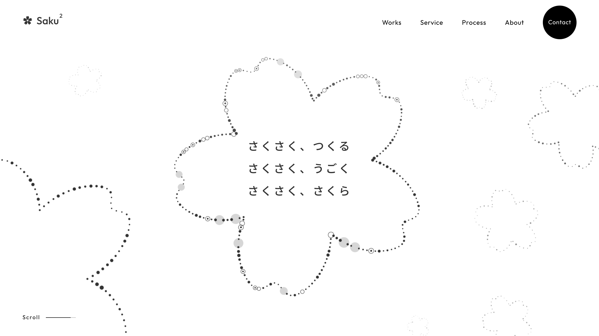
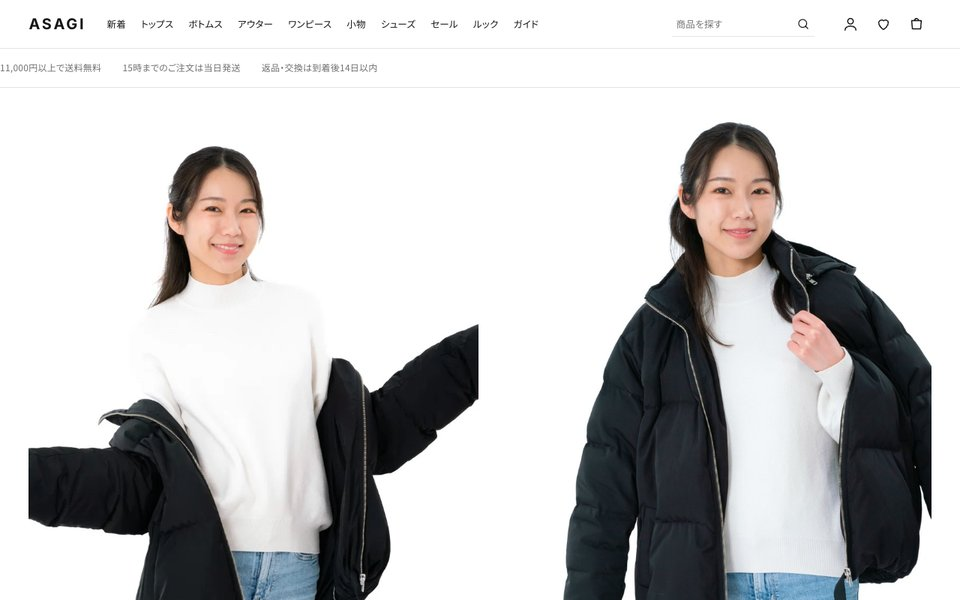
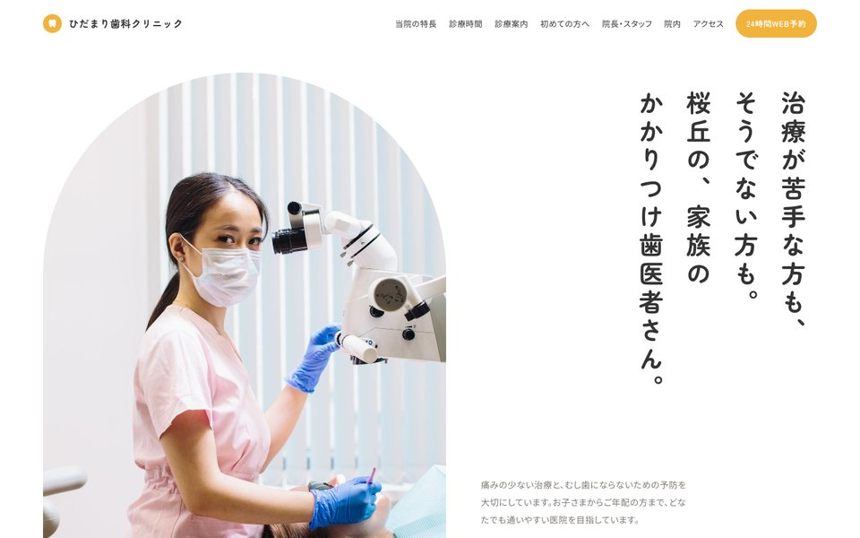
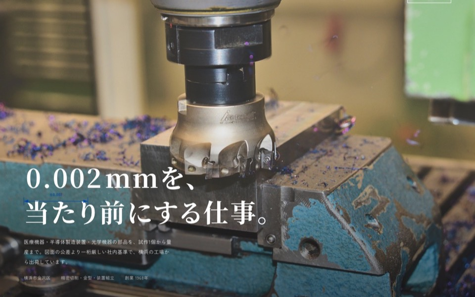
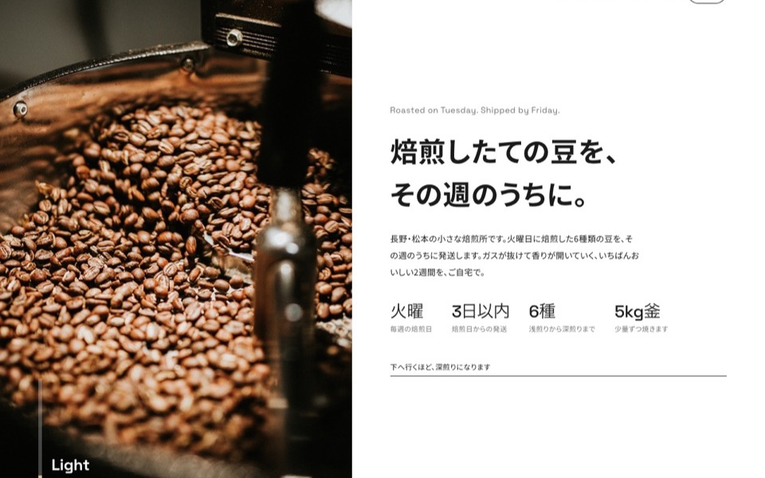
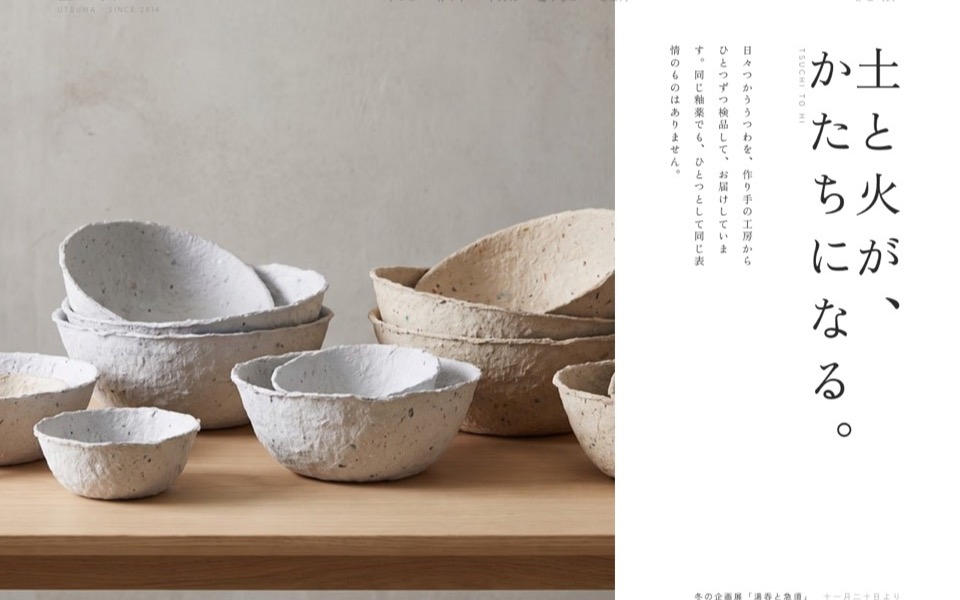
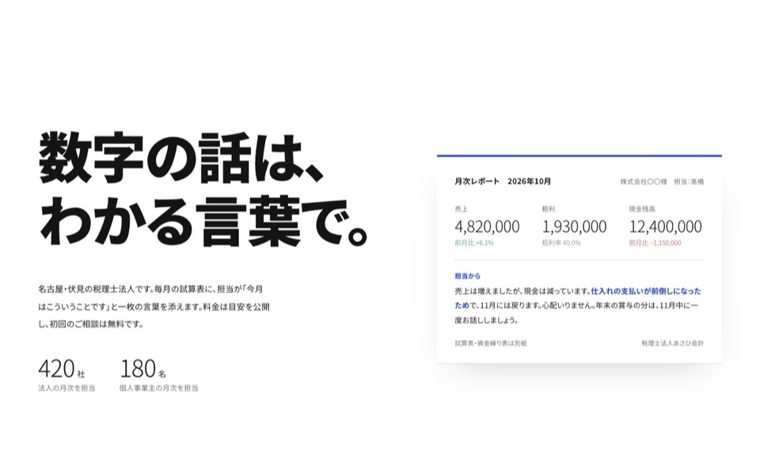
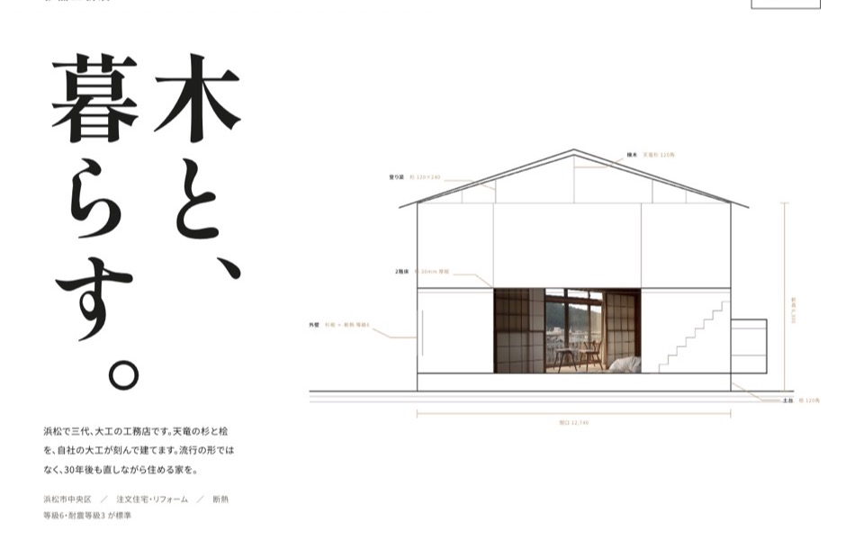
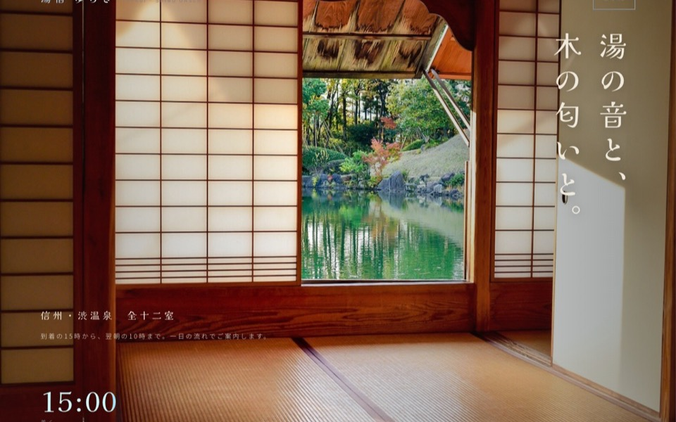
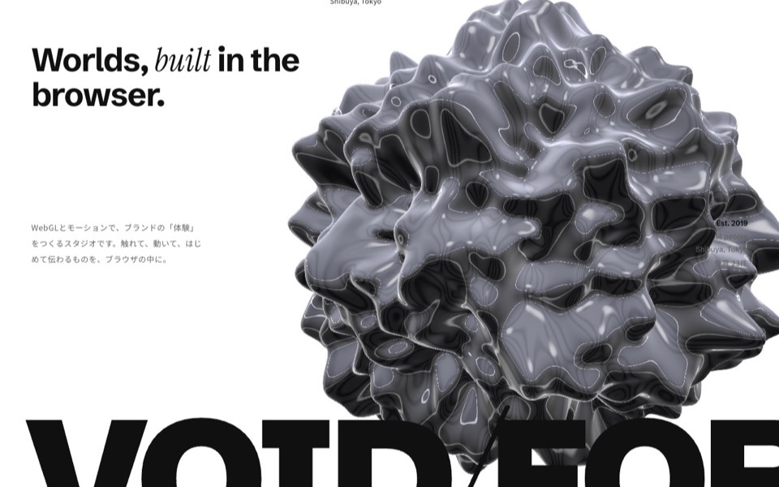

<a id="readme-top"></a>

<div align="center">
  <a href="https://yokoyama-dev.com/">
    
  </a>

  <h1 align="center">Saku²</h1>

  <p align="center">
    Portfolio site of Yuki Yokoyama, a web designer and developer, with ten production-grade website samples for fictional clients.
    <br />
    <br />
    <a href="https://yokoyama-dev.com/"><strong>Visit the site »</strong></a>
    <br />
    <br />
    <a href="https://yokoyama-dev.com/portfolio/">Works</a>
    &middot;
    <a href="https://yokoyama-dev.com/service/">Service</a>
    &middot;
    <a href="https://yokoyama-dev.com/about/">About</a>
    &middot;
    <a href="README.ja.md">日本語</a>
  </p>

  <p align="center">
    <a href="https://github.com/yokoyama0523/portfolio/actions/workflows/check.yml"></a>
    <a href="https://github.com/yokoyama0523/portfolio/actions/workflows/deploy.yml"></a>
    
    
    
    
  </p>
</div>

<p align="center">
  
</p>

<details>
  <summary>Table of Contents</summary>
  <ol>
    <li><a href="#about-the-project">About The Project</a></li>
    <li><a href="#showcase">Showcase</a></li>
    <li><a href="#built-with">Built With</a></li>
    <li><a href="#getting-started">Getting Started</a></li>
    <li><a href="#scripts">Scripts</a></li>
    <li><a href="#project-structure">Project Structure</a></li>
    <li><a href="#architecture">Architecture</a></li>
    <li><a href="#deployment">Deployment</a></li>
    <li><a href="#contributing">Contributing</a></li>
    <li><a href="#license">License</a></li>
    <li><a href="#contact">Contact</a></li>
    <li><a href="#acknowledgments">Acknowledgments</a></li>
  </ol>
</details>

## About The Project

This repository holds [yokoyama-dev.com](https://yokoyama-dev.com/), the portfolio of the web studio Saku², and the ten website samples it presents. Each sample is a complete site for a fictional business, from information design and visual design to working forms.

- **Statically rendered:** every page, including each product page of the shop samples, is prerendered to HTML at build time and hydrated in the browser.
- **Eleven sites in one app:** the portfolio and all ten samples share one React Router app. Stylesheets and fonts load per route, so no site leaks its look into another.
- **Working flows:** reservation, quote and checkout forms validate input, show open slots and calculate totals. The fashion store runs its cart, accounts, orders, stock and admin panel entirely in the browser with `localStorage`.
- **Design tokens:** colors, type, spacing and layout values live in Tailwind CSS v4 `@theme` tokens (CSS custom properties in the samples). Copy and paths live in data files, not in components.
- **Optimized images:** vite-imagetools resizes every image at build time and adds `srcset`, width and height.

<p align="right">(<a href="#readme-top">back to top</a>)</p>

## Showcase

All companies, shops and people are fictional.

| | |
|---|---|
| [](https://yokoyama-dev.com/portfolio/ec/)<br>**ASAGI** — fashion store<br>Catalog, product pages, cart, checkout, account and admin panel | [](https://yokoyama-dev.com/portfolio/dental/)<br>**Madobe Dental** — dental clinic<br>Treatment guide, a booking form with open slots, and a staff booking dashboard |
| [](https://yokoyama-dev.com/portfolio/corp/)<br>**Minato Seiki** — precision parts maker<br>Company site with a drawing-based quote request and factory tours | [](https://yokoyama-dev.com/portfolio/coffee/)<br>**KUMO ROASTERY** — coffee bean store<br>Beans ordered by roast level and a subscription checkout |
| [](https://yokoyama-dev.com/portfolio/ceramic/)<br>**Tsuchi to Hi** — tableware shop<br>One-of-a-kind items and a checkout with gift wrapping | [](https://yokoyama-dev.com/portfolio/tax/)<br>**Asahi Tax Accountants** — tax office<br>Published fees and a first-consultation booking |
| [](https://yokoyama-dev.com/portfolio/house/)<br>**Sugiura Komuten** — home builder<br>Project gallery and open-house reservations | [](https://yokoyama-dev.com/portfolio/ryokan/)<br>**Yuyado Yuragi** — hot spring inn<br>A day that passes as you scroll, and a stay reservation |
| [](https://yokoyama-dev.com/portfolio/salon/)<br>**SOU.hair** — hair salon<br>Menu and a booking form by stylist and time | [](https://yokoyama-dev.com/portfolio/motion/)<br>**VOID/FORM** — creative studio<br>three.js 3D and scroll-driven motion |

<p align="right">(<a href="#readme-top">back to top</a>)</p>

## Built With

| Area | Tools |
|---|---|
| Framework | [React](https://react.dev/) 19.1.10, [React Router](https://reactrouter.com/) 7.18.5 (framework mode, prerendering) |
| Build | [Vite](https://vite.dev/) 7.3.7, [vite-imagetools](https://github.com/JonasKruckenberg/imagetools) 10.0.1 |
| Styling | [Tailwind CSS](https://tailwindcss.com/) 4.3.3 (portfolio), plain CSS (samples), [Fontsource](https://fontsource.org/) |
| Motion | [GSAP](https://gsap.com/) 3.15.0, [Lenis](https://lenis.darkroom.engineering/) 1.3.27, [three.js](https://threejs.org/) 0.187.0, Canvas 2D |
| Quality | [TypeScript](https://www.typescriptlang.org/) 5.8.3 (strict), [Biome](https://biomejs.dev/) 2.5.1 |
| Hosting | [Cloudflare Pages](https://pages.cloudflare.com/), [wrangler](https://developers.cloudflare.com/workers/wrangler/) 4.156.1, GitHub Actions |

<p align="right">(<a href="#readme-top">back to top</a>)</p>

## Getting Started

### Prerequisites

- Node.js 22.18 or later (the exact version is in [`web/.node-version`](web/.node-version))
- npm

### Installation

```sh
git clone https://github.com/yokoyama0523/portfolio.git
cd portfolio/web
npm ci
npm run dev
```

Open the URL that `npm run dev` prints. The portfolio is at `/` and the samples are at `/portfolio/<id>/`.

<p align="right">(<a href="#readme-top">back to top</a>)</p>

## Scripts

Run these from `web/`.

| Command | Description |
|---|---|
| `npm run dev` | Start the development server |
| `npm run check` | Check formatting and lint rules with Biome |
| `npm run format` | Format and apply safe fixes with Biome |
| `npm run typecheck` | Generate route types and run the TypeScript compiler |
| `npm run build` | Prerender every page to `build/client` and write the sitemap, `robots.txt`, `_headers` and `_redirects` |
| `npm run deploy -- --branch=<branch>` | Upload `build/client` to Cloudflare Pages (needs `CLOUDFLARE_API_TOKEN` and `CLOUDFLARE_ACCOUNT_ID`) |

<p align="right">(<a href="#readme-top">back to top</a>)</p>

## Project Structure

```
web/
├── app/
│   ├── config.ts            Site-wide settings: name, URL, paths, icons
│   ├── root.tsx             HTML shell and error boundary
│   ├── routes.ts            Route table for the portfolio and every sample
│   ├── site/                The portfolio
│   │   ├── app.css          Design tokens and custom utilities
│   │   ├── components/      UI components (orbit/ is the top-page animation)
│   │   ├── data/            Copy, paths and images
│   │   └── routes/          Home, Works, Service, About
│   ├── samples/
│   │   ├── <id>/            One sample: case.json, content/, styles/, pages/, routes.ts, assets/, media/
│   │   └── shared/          Components, form helpers and validation shared by samples
│   └── shared/              Meta tags and analytics
├── scripts/                 Post-build steps: sitemap, _headers, _redirects
└── public/                  Static files served as-is
```

<p align="right">(<a href="#readme-top">back to top</a>)</p>

## Architecture

- **Routing:** `app/routes.ts` combines the portfolio routes with each sample's `routes.ts`. Every sample has its own layout, fonts and stylesheets.
- **Rendering:** `ssr: false` with prerendering. Where output depends on the query string, it is read after hydration so the prerendered HTML matches the first client render.
- **State:** the shop samples keep their state in a React context backed by `localStorage`, each sample under its own keys.
- **Content:** each sample's copy lives in `content/`, and the portfolio's copy lives in `site/data/`. `case.json` drives the works list, the footer, the page count, the sitemap and the legacy-URL redirects.
- **Top-page animation:** split into `orbit/math.ts`, `orbit/scene.ts` (dot formations), `orbit/timeline.ts` (stages and text reveals) and `orbit/renderer.ts` (Canvas 2D).

<p align="right">(<a href="#readme-top">back to top</a>)</p>

## Deployment

| Branch | Purpose | Deployed to |
|---|---|---|
| `feature/*` | Work in progress | — |
| `develop` | Integration | — |
| `staging` | Pre-release check | https://staging.yokoyama-dev-portfolio.pages.dev/ |
| `main` | Production | https://yokoyama-dev.com/ |

- [`check.yml`](.github/workflows/check.yml) runs Biome, the type check and the build on every pull request and on pushes to `develop`, `staging` and `main`.
- [`deploy.yml`](.github/workflows/deploy.yml) builds and uploads to Cloudflare Pages on pushes to `staging` and `main`. It needs the repository secrets `CLOUDFLARE_API_TOKEN` and `CLOUDFLARE_ACCOUNT_ID`.

<p align="right">(<a href="#readme-top">back to top</a>)</p>

## Contributing

1. Create a branch from `develop`: `git checkout -b feature/<name>`
2. Make your changes and run `npm run check`, `npm run typecheck` and `npm run build`
3. Open a pull request into `develop`. Releases go `develop` → `staging` → `main` by pull request.

Conventions:

- Use design tokens. Don't use Tailwind arbitrary values (`[...]`); add a token or an `@utility` instead.
- Keep copy, paths and images in `data/`, `content/` or `config.ts`, not in components.
- No code comments. Names carry the meaning.
- Pin every dependency to an exact version that has been public for at least two weeks.

<p align="right">(<a href="#readme-top">back to top</a>)</p>

## License

© 2026 Yuki Yokoyama. All rights reserved. No license is granted to use, copy or redistribute this code or its assets.

<p align="right">(<a href="#readme-top">back to top</a>)</p>

## Contact

Yuki Yokoyama (Saku²) — [yokoyama-dev.com](https://yokoyama-dev.com/) · [CrowdWorks](https://crowdworks.jp/public/employees/5842694)

<p align="right">(<a href="#readme-top">back to top</a>)</p>

## Acknowledgments

- Photos in the samples come from [PAKUTASO](https://www.pakutaso.com/), [Unsplash](https://unsplash.com/), [Pexels](https://www.pexels.com/) and [Pixabay](https://pixabay.com/). People shown are models. Sources are listed in each sample's `assets/CREDITS.txt`.
- [Best-README-Template](https://github.com/othneildrew/Best-README-Template) for the structure of this README.

<p align="right">(<a href="#readme-top">back to top</a>)</p>
